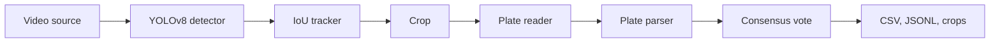

# VRPR: Vehicle Registration Plate Recognition


VRPR finds Indian vehicle registration plates in video and reports each vehicle once. It works on
files, cameras and network streams, and writes results as CSV and JSON Lines with an image of each
plate.

It started as a Python Programming course project at GD Goenka University.

## How it works



- **Tracking** gives each plate a stable identity across frames.
- **The plate reader** is a small model trained only on number plates, which copes with small
  and blurred plates. Crops it is unsure about go to EasyOCR, which is better at two-line
  plates. `ocr.engine` chooses between them.
- **The parser** handles standard, Bharat series and two-line plates, and repairs common OCR
  confusions such as `O` for `0`, but only where the plate layout requires a digit or a letter.
- **Consensus** takes the plate that several frames agree on, so one bad frame cannot produce a
  wrong result. OCR stops once a plate is settled, so it is not repeated needlessly.

See [docs/architecture.md](docs/architecture.md) for the design.

## Install

Python 3.10 to 3.12 is recommended for the ML dependencies.

```bash
git clone https://github.com/rahulmandal0207/vrpr.git
cd vrpr
python -m venv .venv
```

Activate the environment with `.venv\Scripts\activate` on Windows or `source .venv/bin/activate`
elsewhere. Then install:

```bash
pip install -e ".[ml]"
```

Add `dataset` to the extras to download training data, and `dev` to run the tests.

On Windows with Smart App Control on, the `vrpr.exe`, `pip.exe` and `pytest.exe` launchers that pip
creates are unsigned and may be blocked. Run them through Python instead, for example
`python -m vrpr web` or `python -m pytest`. Create the environment from the signed Python on
[python.org](https://www.python.org/downloads/windows/) too: a venv's `python.exe` is copied from
the Python it was made with, and an unsigned copy can also be blocked.

## Quick start

A trained model is included as `models/best.pt`. To use your own, train one or replace that file.

```bash
vrpr run traffic.mp4
```

`vrpr run` also accepts a camera index or a stream URL:

```bash
vrpr run 0 --display
```

```bash
vrpr run rtsp://camera.local/stream --config configs/default.yaml --save-video
```

Each run writes to its own folder, `output/<run id>/`:

| File | Contents |
| --- | --- |
| `plates.csv`, `plates.jsonl` | One record per vehicle, written a few seconds after it leaves the picture. `confirmed` is false when too few readings agreed, so the plate is a best guess. `state`, `rto_code`, `rto_office`, `rto_area` and `registered_year` describe the number: see [Plate details](#plate-details) |
| `crops/` | The clearest image of each plate |
| `summary.json` | Frames, speed, OCR calls, plates found and tracks left unread |
| `annotated.mp4` | The video with boxes drawn, with `--save-video` |

To check how a piece of text would be read as a plate:

```bash
vrpr parse "HR 26 DK 8337"
```

## Plate details

An Indian registration number says where it was issued. VRPR reads that from the number itself
and a bundled table of about 1,300 RTO codes, so it works offline, costs nothing and needs no API
key. Each plate gets:

| Field | Example for `UP16AU6426` | Example for `22BH1234AB` |
| --- | --- | --- |
| `state` | Uttar Pradesh | (blank: valid in every state) |
| `rto_code` | UP-16 | (blank) |
| `rto_office` | Noida | (blank) |
| `rto_area` | Gautam Buddha Nagar district | (blank) |
| `registered_year` | (blank) | 2022 |

The web page shows the same on each confirmed plate card, and `vrpr parse` prints it. The
files have details for every plate, so filter on `confirmed` before relying on them. Former state codes
such as `TS` (now `TG`) and `OR` (now `OD`) are recognised. Codes missing from the table give only
the state. The details describe the number as read, so a misread plate gets the details of a
different number: that is why the page shows none for unconfirmed plates.

The table comes from Wikipedia, under CC BY-SA 4.0: see
[src/vrpr/data/CREDITS.md](src/vrpr/data/CREDITS.md). Rebuild it with
`python scripts/build_rto_codes.py`.

VRPR does not look up a vehicle's owner, model or insurance. There is no free official API for
that: Vahan data is sold through KYC providers for checking a vehicle whose owner agrees, and
using it on plates read from traffic would look up people who have not. See
[docs/privacy.md](docs/privacy.md#vehicle-owner-lookups).

## Web interface

A browser page does the same as `vrpr run`: pick a video from `data/videos`, upload one, or enter
a camera number or stream URL, then watch a live preview and browse the plates found. Earlier runs
are listed under **Past runs**.

```bash
pip install -e ".[ml,web]"
```

```bash
vrpr web
```

Run it from the project folder. It opens `http://localhost:8501`, and only this computer can reach
it. Settings in the side panel start from `configs/default.yaml`. Uploads are saved to
`data/uploads/`, which git ignores.

### Advanced options

The side panel's **Advanced options** change how each plate is cleaned up, found and read:

- **Image filters** (OpenCV): grayscale, enlarging small plates, the margin around the plate,
  noise reduction, brightness, contrast (CLAHE or equalize), sharpening, black and white
  (Otsu or adaptive threshold) and inverting light text on dark plates.
- **Plate detector** (YOLO): image size, the overlap limit for merging boxes, and test-time
  augmentation.
- **Text reader**: which reader to use (the plate model, EasyOCR, or both), the confidence below
  which the plate model hands a plate to EasyOCR, and the confidence below which text is ignored.
  For EasyOCR: the decoder (greedy or beam search), its text-finding thresholds, magnification,
  the smallest text size, the low-contrast retry, and reading the text rotated.

The image filters apply to both readers. With no filter on, each reader gets the crop the way
its model works best: gray and enlarged for EasyOCR, in colour at its own size for the plate
model.

To see what a change does before running a whole video, open **Try settings on one frame** on the
Run tab. Pick a frame where a plate is clear and close: the page shows each detected plate as found,
the image after the filters, which is what the reader saw, and which reader read it. When the
plate model's answer was set aside for EasyOCR's, both are shown. A single frame is less
reliable than a full run, which reads each plate on many frames and votes.

**Reset** returns the options to `configs/default.yaml`, whose values reproduce VRPR's normal
results. **Save settings** downloads them as YAML for the command line:

```bash
vrpr run traffic.mp4 --config vrpr-settings.yaml
```

The same settings can be set in a config file: see the `detector`, `ocr` and `preprocess` sections
of `configs/default.yaml`.

## Public demo

A public demo runs at [vrprdemo.streamlit.app](https://vrprdemo.streamlit.app/), on Streamlit
Community Cloud. It is served from the [`demo`](https://github.com/rahulmandal0207/vrpr/tree/demo)
branch, which adds the hosting files, a CC0 sample clip and a public mode to this page: a 15-second
cap, private per-visitor sessions, and local-only settings shown greyed out. It runs on a shared CPU
without a GPU, so it is much slower than VRPR on your own computer.

## Train a model

The dataset is not in this repository. Download a YOLO-format dataset from Roboflow, or use any
dataset that has a `data.yaml`. For Roboflow, copy `.env.example` to `.env` and put your private API
key in it. Git ignores `.env`, and a `ROBOFLOW_API_KEY` set in your shell takes priority over it.

```bash
vrpr dataset --workspace <workspace> --project <project> --version 3
```

```bash
vrpr train --data data/plates/data.yaml --epochs 100
```

Training saves the best weights to `models/best.pt`, which is where `vrpr run` looks by default.

## Measure accuracy

There are two separate questions, and both need your own data.

**Does it find plates?** This reports mAP, precision and recall on the dataset:

```bash
vrpr validate --data data/plates/data.yaml
```

**Does it read them correctly?** List the plates in a video in a CSV with a `plate` column, then
score a run against it:

```bash
vrpr evaluate --expected labels.csv --predicted output/<run id>/plates.csv
```

## Configuration

Settings live in YAML. [configs/default.yaml](configs/default.yaml) documents every option, and
your file only needs the values it changes. Unknown or out-of-range settings stop the run with a
clear message.

## Live preview

`--display` needs a build of OpenCV with GUI support. Ultralytics installs `opencv-python` and
EasyOCR installs `opencv-python-headless`. They occupy the same `cv2` module and whichever installed
last wins, so if the preview reports no GUI support, reinstall the GUI build:

```bash
pip uninstall -y opencv-python opencv-python-headless
```

```bash
pip install opencv-python
```

Use `--save-video` instead on servers.

## Docker

```bash
docker build -t vrpr .
```

```bash
docker run --rm -v "$PWD/data:/data" vrpr run /data/traffic.mp4 --weights /data/best.pt --output /data/output --device cpu
```

The image runs on CPU as a non-root user.

## Development

```bash
pip install -e ".[dev]"
```

```bash
pytest --cov
```

```bash
ruff check . && ruff format --check . && mypy
```

The default test run uses fake models, so it needs no GPU or weights. `pytest -m integration` runs
against real YOLO and EasyOCR. See [CONTRIBUTING.md](CONTRIBUTING.md).

## Privacy

Registration numbers and images of vehicles can identify people. Before using VRPR on real traffic,
read [docs/privacy.md](docs/privacy.md). Logs mask plate numbers, but the output files do not.

## License

VRPR's own code is under the MIT License. It depends on AGPL-3.0 software, which affects how you can
distribute it: see [THIRD_PARTY_NOTICES.md](THIRD_PARTY_NOTICES.md).
