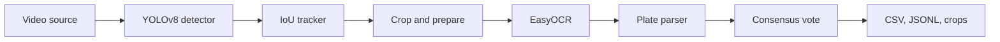

# VRPR: Vehicle Registration Plate Recognition


VRPR finds Indian vehicle registration plates in video and reports each vehicle once. It works on
files, cameras and network streams, and writes results as CSV and JSON Lines with an image of each
plate.

It started as a Python Programming course project at GD Goenka University.

## How it works



- **Tracking** gives each plate a stable identity across frames.
- **The parser** handles standard, Bharat series and two-line plates, and repairs common OCR
  confusions such as `O` for `0`, but only where the plate layout requires a digit or a letter.
- **Consensus** takes the plate that several frames agree on, so one bad frame cannot produce a
  wrong result. OCR stops once a plate is settled, so it is not repeated needlessly.

See [docs/architecture.md](docs/architecture.md) for the design.

## Install

Python 3.10 to 3.12 is recommended for the ML dependencies.

```bash
git clone https://github.com/rahulmandal0207/vrpr.git
cd vrpr
python -m venv .venv
```

Activate the environment with `.venv\Scripts\activate` on Windows or `source .venv/bin/activate`
elsewhere. Then install:

```bash
pip install -e ".[ml]"
```

Add `dataset` to the extras to download training data, and `dev` to run the tests.

## Quick start

A model is not included, so train one first or copy your own to `models/best.pt`.

```bash
vrpr run traffic.mp4
```

`vrpr run` also accepts a camera index or a stream URL:

```bash
vrpr run 0 --display
```

```bash
vrpr run rtsp://camera.local/stream --config configs/default.yaml --save-video
```

Each run writes to its own folder, `output/<run id>/`:

| File | Contents |
| --- | --- |
| `plates.csv`, `plates.jsonl` | One record per vehicle, written a few seconds after it leaves the picture. `confirmed` is false when too few readings agreed, so the plate is a best guess |
| `crops/` | The clearest image of each plate |
| `summary.json` | Frames, speed, OCR calls, plates found and tracks left unread |
| `annotated.mp4` | The video with boxes drawn, with `--save-video` |

To check how a piece of text would be read as a plate:

```bash
vrpr parse "HR 26 DK 8337"
```

## Web interface

A browser page does the same as `vrpr run`: pick a video from `data/videos`, upload one, or enter
a camera number or stream URL, then watch a live preview and browse the plates found. Earlier runs
are listed under **Past runs**.

```bash
pip install -e ".[ml,web]"
```

```bash
vrpr web
```

Run it from the project folder. It opens `http://localhost:8501`, and only this computer can reach
it. Settings in the side panel start from `configs/default.yaml`. Uploads are saved to
`data/uploads/`, which git ignores.

## Public demo

The repository can run as a public web page on
[Streamlit Community Cloud](https://streamlit.io/cloud), which is free and redeploys by itself
whenever the chosen branch on GitHub changes.

`streamlit_app.py` starts the same page in public mode. Public mode:

- offers only the bundled sample in `samples/` and uploads up to 50 MB, with no cameras, streams
  or server folders
- analyses the first 15 seconds of each video, on the CPU, one run at a time, reading plates on
  every second frame because OCR is the slowest stage on a CPU
- shows the speed and time left while it works, since a small shared CPU analyses video more
  slowly than it plays
- keeps each visitor's uploads and results in a private temporary folder, deleted after about
  2 hours
- hides the model, device and save-video settings, and links back to this source code, which the
  AGPL-3.0 dependencies require

To publish it:

1. Sign in at [share.streamlit.io](https://share.streamlit.io) with GitHub.
2. Choose **Create app**, then **Deploy a public app from GitHub**.
3. Pick this repository and the branch to publish, and set the main file to `streamlit_app.py`.
4. Under **Advanced settings**, choose Python 3.12, then deploy.

The first build installs PyTorch, Ultralytics and EasyOCR and takes several minutes. Later pushes to
the branch redeploy automatically. The host gives about 2.7 GB of memory, and a run peaks at about
1.2 GB. An app with no visitors for a while goes to sleep, and the next visitor wakes it, which
takes a minute.

The host caps CPU time at a fraction of a core to 2 cores, but reports every core of the machine.
VRPR sizes PyTorch's threads to the cap, read from the container's cgroup settings, because
extra threads spend the allowance waiting on each other.

`requirements.txt` and `packages.txt` exist only for the host: install locally with `pip` and
`pyproject.toml` as above. The trained model is committed as `models/best.pt` so the host can load
it.

To try public mode locally:

```bash
streamlit run streamlit_app.py
```

## Train a model

The dataset is not in this repository. Download a YOLO-format dataset from Roboflow, or use any
dataset that has a `data.yaml`. For Roboflow, copy `.env.example` to `.env` and put your private API
key in it. Git ignores `.env`, and a `ROBOFLOW_API_KEY` set in your shell takes priority over it.

```bash
vrpr dataset --workspace <workspace> --project <project> --version 3
```

```bash
vrpr train --data data/plates/data.yaml --epochs 100
```

Training saves the best weights to `models/best.pt`, which is where `vrpr run` looks by default.

## Measure accuracy

There are two separate questions, and both need your own data.

**Does it find plates?** This reports mAP, precision and recall on the dataset:

```bash
vrpr validate --data data/plates/data.yaml
```

**Does it read them correctly?** List the plates in a video in a CSV with a `plate` column, then
score a run against it:

```bash
vrpr evaluate --expected labels.csv --predicted output/<run id>/plates.csv
```

## Configuration

Settings live in YAML. [configs/default.yaml](configs/default.yaml) documents every option, and
your file only needs the values it changes. Unknown or out-of-range settings stop the run with a
clear message.

## Live preview

`--display` needs a build of OpenCV with GUI support. Ultralytics installs `opencv-python` and
EasyOCR installs `opencv-python-headless`. They occupy the same `cv2` module and whichever installed
last wins, so if the preview reports no GUI support, reinstall the GUI build:

```bash
pip uninstall -y opencv-python opencv-python-headless
```

```bash
pip install opencv-python
```

Use `--save-video` instead on servers.

## Docker

```bash
docker build -t vrpr .
```

```bash
docker run --rm -v "$PWD/data:/data" vrpr run /data/traffic.mp4 --weights /data/best.pt --output /data/output --device cpu
```

The image runs on CPU as a non-root user.

## Development

```bash
pip install -e ".[dev]"
```

```bash
pytest --cov
```

```bash
ruff check . && ruff format --check . && mypy
```

The default test run uses fake models, so it needs no GPU or weights. `pytest -m integration` runs
against real YOLO and EasyOCR. See [CONTRIBUTING.md](CONTRIBUTING.md).

## Privacy

Registration numbers and images of vehicles can identify people. Before using VRPR on real traffic,
read [docs/privacy.md](docs/privacy.md). Logs mask plate numbers, but the output files do not.

## License

VRPR's own code is under the MIT License. It depends on AGPL-3.0 software, which affects how you can
distribute it: see [THIRD_PARTY_NOTICES.md](THIRD_PARTY_NOTICES.md).
